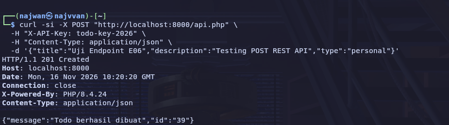
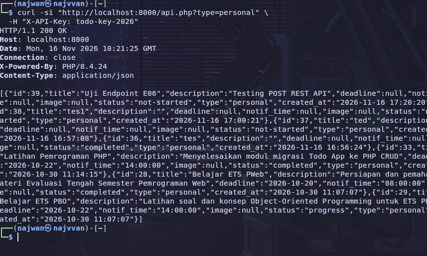
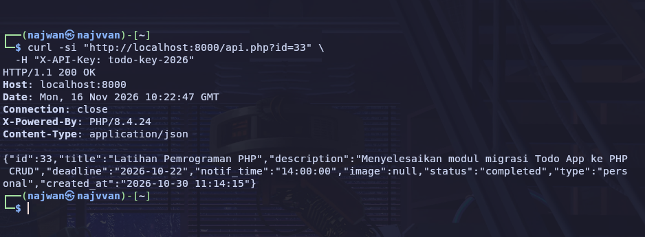
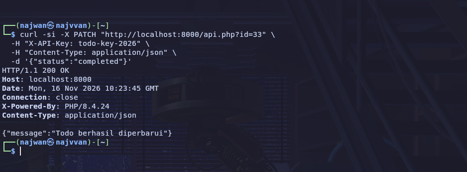
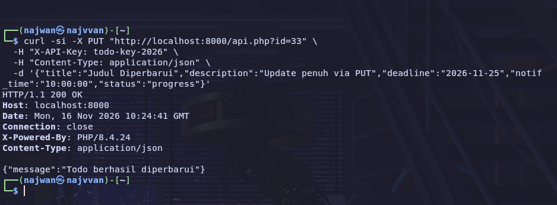
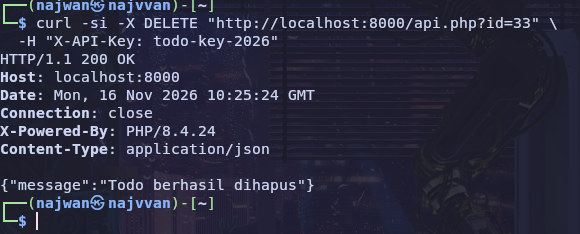
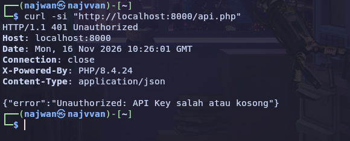
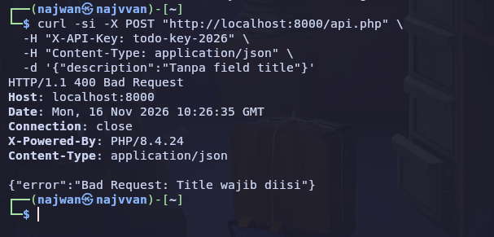
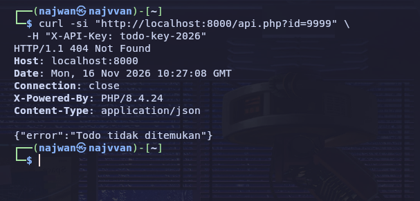
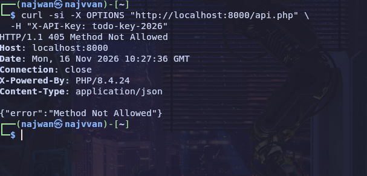

# [E06] The Endpoint of Portals - ToDo App
## Identitas
- Nama : Najwan Sigit Cahya Buana
- NRP : 5025251031
- Kelas : Pemrograman Web (A)

## Deskripsi
Pada branch ini, dilakukan migrasi arsitektur backend aplikasi Organizational Todo App dari pemrosesan form tradisional berbasis redirect (`actions.php`) menjadi **RESTful API** berbasis JSON (`api.php`). Endpoint mendukung operasi CRUD lengkap menggunakan metode HTTP standar (`GET`, `POST`, `PUT`, `PATCH`, dan `DELETE`), mengimplementasikan kode status HTTP yang sesuai baik untuk skenario sukses (`200 OK`, `201 Created`) maupun penanganan error (`400 Bad Request`, `401 Unauthorized`, `404 Not Found`, `405 Method Not Allowed`), serta dilengkapi autentikasi berbasis **API Key** melalui header `X-API-Key`. Pada sisi frontend, skrip `index.js` juga telah diperbarui untuk berkomunikasi secara asinkron dengan REST API menggunakan `fetch()`.

| Method | Endpoint | Deskripsi | Kode Sukses | Kode Error |
| :--- | :--- | :--- | :--- | :--- |
| `GET` | `/api.php?type=personal` | Mengambil seluruh daftar todo berdasarkan kategori | `200 OK` | `401` |
| `GET` | `/api.php?id={id}` | Mengambil detail satu data todo berdasarkan ID | `200 OK` | `400`, `401`, `404` |
| `POST` | `/api.php` | Membuat data todo baru | `201 Created` | `400`, `401` |
| `PATCH` | `/api.php?id={id}` | Memperbarui sebagian data todo (misal: status selesai) | `200 OK` | `400`, `401`, `404` |
| `PUT` | `/api.php?id={id}` | Memperbarui seluruh data detail todo | `200 OK` | `400`, `401`, `404` |
| `DELETE` | `/api.php?id={id}` | Menghapus data todo berdasarkan ID | `200 OK` | `400`, `401`, `404` |

## Link Website
-

## Preview
### 1. Pengujian Endpoint POST - Create Todo (`201 Created`)
Menampilkan pengujian penambahan data todo baru ke endpoint `POST /api.php` dengan header autentikasi `X-API-Key` dan payload JSON yang valid, menghasilkan status **`201 Created`** beserta ID todo yang baru dibuat.

### 2. Pengujian Endpoint GET - Ambil Semua Todo (`200 OK`)
Menampilkan pengujian pengambilan seluruh daftar tugas melalui `GET /api.php?type=personal` yang mengembalikan status **`200 OK`** beserta array objek JSON seluruh data todo.

### 3. Pengujian Endpoint GET - Ambil Detail Todo by ID (`200 OK`)
Menampilkan pengujian pengambilan detail spesifik satu tugas melalui `GET /api.php?id={id}` yang mengembalikan status **`200 OK`** beserta data JSON todo terkait.

### 4. Pengujian Endpoint PATCH - Update Sebagian Data (`200 OK`)
Menampilkan pengujian pembaruan parsial (mengubah `status` menjadi `completed`) melalui `PATCH /api.php?id={id}` dengan respons **`200 OK`**.

### 5. Pengujian Endpoint PUT - Update Seluruh Data (`200 OK`)
Menampilkan pengujian pembaruan penuh seluruh atribut todo (`title`, `description`, `deadline`, `notif_time`, `status`) melalui `PUT /api.php?id={id}` dengan respons **`200 OK`**.

### 6. Pengujian Endpoint DELETE - Hapus Todo (`200 OK`)
Menampilkan pengujian penghapusan data todo melalui `DELETE /api.php?id={id}` yang mengembalikan status **`200 OK`** dan pesan konfirmasi penghapusan.

### 7. Penanganan Error Autentikasi (`401 Unauthorized`)
Menampilkan penolakan akses ketika request dikirim ke `/api.php` tanpa menyertakan header `X-API-Key` atau menggunakan API Key yang salah, menghasilkan status **`401 Unauthorized`**.

### 8. Penanganan Error Validasi Data (`400 Bad Request`)
Menampilkan validasi input ketika request `POST /api.php` dikirim tanpa field wajib `title` (atau parameter `id` tidak valid), menghasilkan status **`400 Bad Request`**.

### 9. Penanganan Error Resource Tidak Ditemukan (`404 Not Found`)
Menampilkan respons ketika client mengakses atau memodifikasi ID todo yang tidak terdaftar di database (`GET /api.php?id=9999`), menghasilkan status **`404 Not Found`**.

### 10. Penanganan Error Metode HTTP Tidak Didukung (`405 Method Not Allowed`)
Menampilkan respons ketika client mengirimkan metode HTTP yang tidak didukung oleh endpoint (`OPTIONS /api.php`), menghasilkan status **`405 Method Not Allowed`**.

