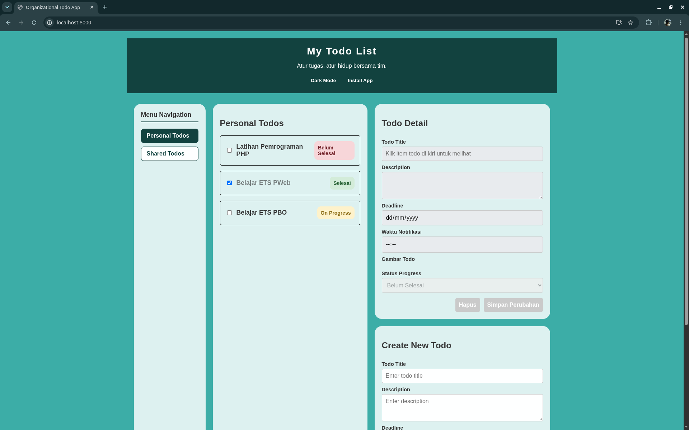
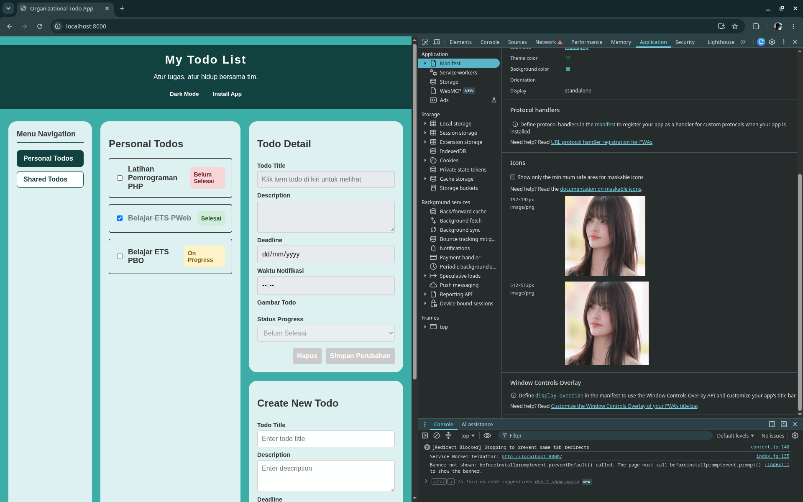
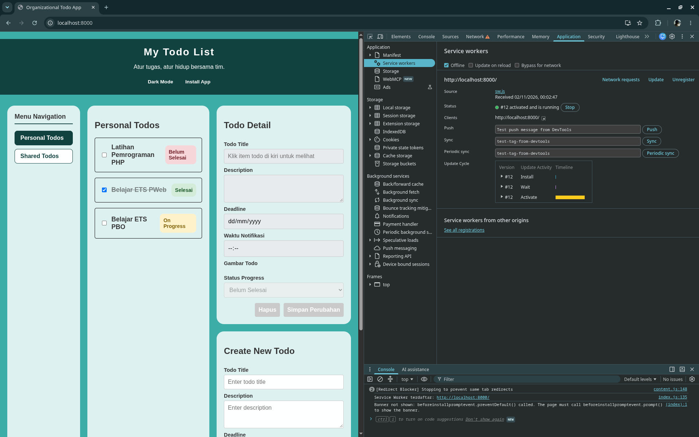
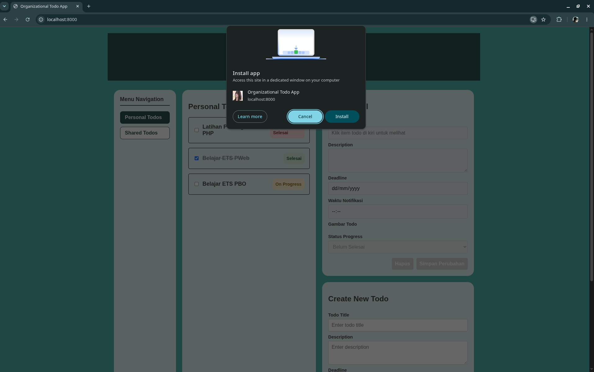
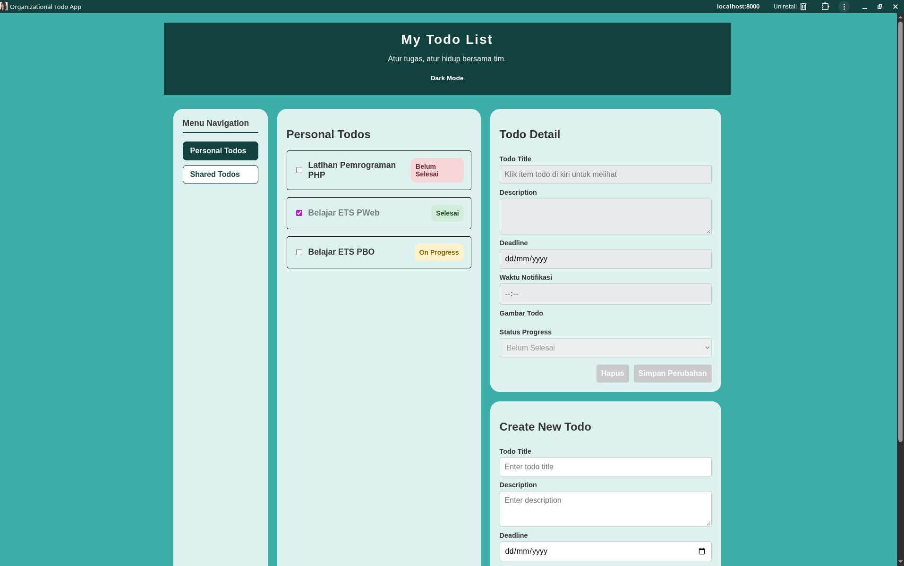
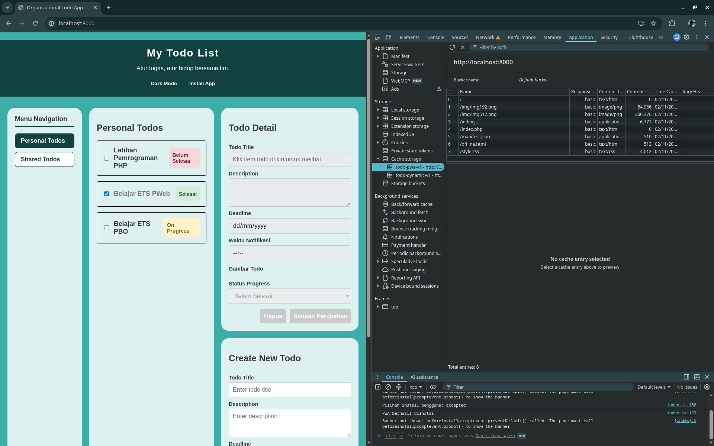
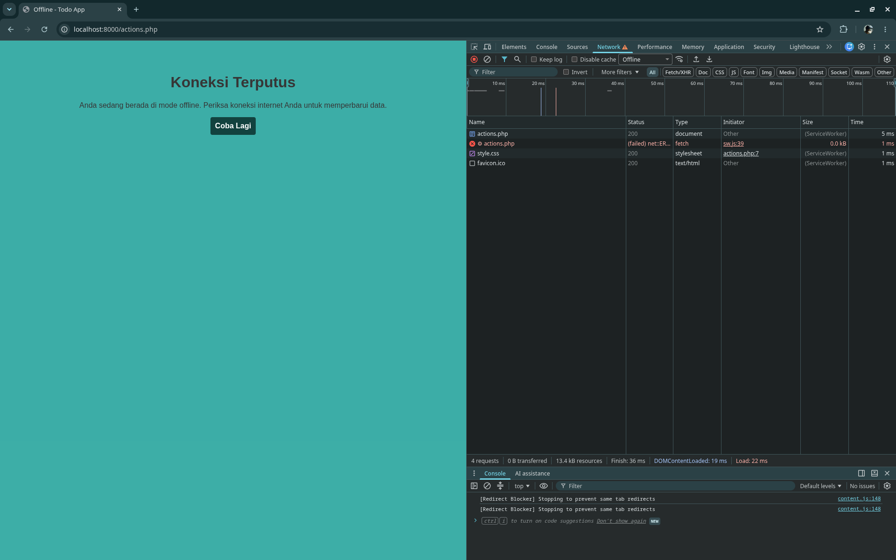
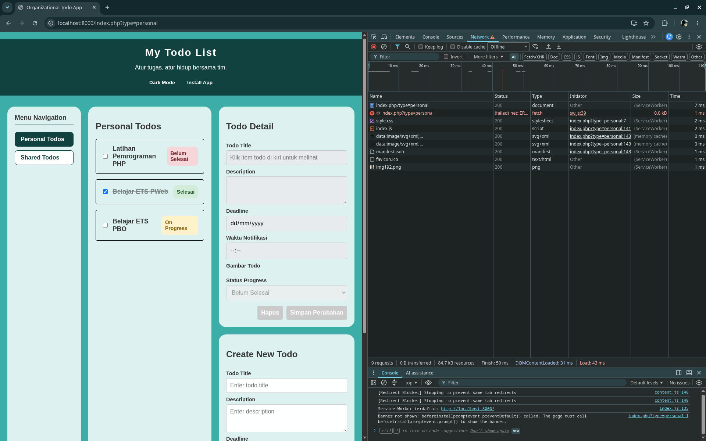

# [E05] The Style Warrior - ToDo App
## Identitas
- Nama : Najwan Sigit Cahya Buana
- NRP : 5025251031
- Kelas : Pemrograman Web (A)

## Deskripsi
Pada branch ini, dilakukan pembaruan dan peningkatan pada aplikasi Organizational Todo App menjadi Progressive Web App (PWA) untuk mendukung fungsionalitas offline-first serta memungkinkan instalasi aplikasi secara standalone. Penambahan utama mencakup berkas manifest.json yang mendefinisikan metadata dan identitas visual aplikasi, skrip Service Worker sw.js yang bertugas mengelola precaching app shell serta strategi caching per resource, halaman fallback offline.html saat jaringan terputus.

## Link Website
-

## Preview
### 1. Desktop Preview

### 2. Verifikasi Web App Manifest
Menampilkan properti `manifest.json` yang terdeteksi tanpa error pada tab **DevTools > Application > Manifest**, termasuk mode tampilan `standalone` dan pratinjau ikon $192\times192$ px serta $512\times512$ px.

### 3. Status Registrasi Service Worker
Menampilkan Service Worker (`sw.js`) yang berhasil terdaftar dan berstatus **Activated and is running** pada tab **DevTools > Application > Service Workers**.

### 4. Prompt Instalasi Aplikasi (beforeinstallprompt Event)
Menampilkan dialog konfirmasi instalasi PWA kustom yang dipicu saat tombol **Install App** diklik oleh pengguna.

### 5. Tampilan Aplikasi Terinstal (Standalone Window)
Menampilkan aplikasi Todo yang berjalan di jendela tersendiri tanpa *address bar* browser setelah berhasil diinstal ke sistem.

### 6. Penyiapan Cache Storage (App Shell Precaching)
Menampilkan daftar aset statis utama (`index.php`, `style.css`, `index.js`, `manifest.json`, `offline.html`, dan ikon) yang tersimpan di dalam **Cache Storage (`todo-pwa-v1`)**.

### 7. Halaman Fallback Offline (offline.html)
Menampilkan tampilan pengganti `offline.html` ketika pengguna mengakses halaman baru saat jaringan berada dalam kondisi **Offline** (DevTools Network throttling).

### 8. Pengujian Halaman Utama pada Mode Offline
Menampilkan halaman utama aplikasi yang tetap dapat dimuat sempurna saat opsi **Offline** diaktifkan pada DevTools Network, di mana seluruh aset disajikan langsung melalui **`(ServiceWorker)`**.

